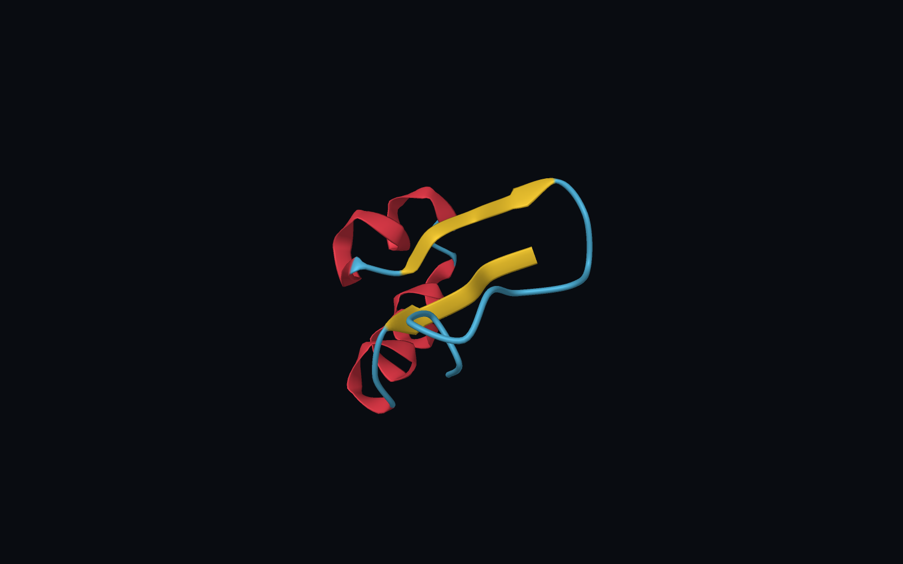

# JlMol user guide

## Launch the app

On macOS, extract the ZIP and open `JlMol.app`. On Windows, run the MSI and open **JlMol** from the Start menu. On Linux, extract the archive and run `bin/jlmol` from the extracted directory. The viewport requires OpenGL 4.1. See the [packaging guide](packaging.md) for verified configurations and build instructions.

The sample paths in this guide start at the JlMol project directory. In a source checkout, use the repository root. In a package, use `JlMol.app/Contents/Resources/jlmol` on macOS or `share/jlmol` inside the Windows install directory or Linux archive. On macOS, Finder's **Show Package Contents** opens the app bundle.

## View a protein

1. Choose **File > Open Structure** and open `resources/1CRN.pdb`.
2. Choose **Representation > Cartoon**, then **Color > By Secondary Structure**. Crambin displays red helix ribbons, yellow beta strands, and blue loops.
3. Drag with the left mouse button to orbit. Drag with the right or middle button to pan. Scroll to zoom, or press **F** to fit the structure again.
4. Switch to **Ball and Stick** to inspect individual atoms. Click an atom to inspect it. Shift-click atoms in order to measure a distance, angle, or dihedral.



Use the Object Explorer to switch between loaded structures, hide them, or open their representation and opacity controls. For camera presets, labels, lighting, and backgrounds, see the [rendering guide](rendering.md).

## Play a trajectory and inspect a plot

1. Open `test/data/water.xyz` and make it the active object in the Object Explorer.
2. Choose **File > Attach Trajectory** and select `test/data/water_analysis.xyz`. Hide the crambin object if it is still open and press **F** to fit the water molecule.
3. Press **Play** in the **Trajectory** dock or select frame **3** directly.
4. Open **Analysis > Trajectory Analysis**. Choose **RMSD**, turn **Align** off, and click **Calculate**. Click a point on the plot to seek to its frame. The sample's oxygen moves while its hydrogens stay fixed.

Use topology and trajectory files from the same simulation so their atom orders match. The [trajectory guide](trajectories.md) covers XTC, TRR, DCD, linked RMSF and PCA plots, and periodic cells.

## Script, save, and export

Paste the following into the **Julia Console** and click **Run** to open the bundled example. It loads the protein and water trajectory, prints their measurements, and leaves the protein active.

```julia
using JlMol
include(joinpath(pkgdir(JlMol), "examples", "quickstart.jl"))
```

Click the viewport and press **F** to fit the protein after running the example.

Use **File > Save Workspace** to save the scene and camera, or **File > Export Figure** for a PNG or SVG. Use **File > Export Animation** with an attached trajectory to save an animated PNG. See the [scripting guide](scripting.md), [workspace guide](workspaces.md), and [figure export guide](figure_export.md).
